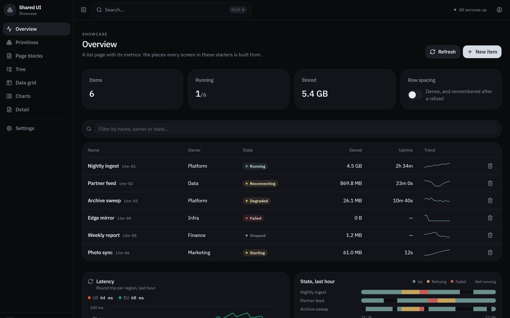

# shared-ui

[](https://koderi-dp.github.io/shared-ui/)

The shared UI for the koderi starters, published as a shadcn registry. It is the source of
truth for the look of `redix-ui-starter` (a Vite SPA) and `tanstack-app-starter` (TanStack
Start), and it ships with a showcase app that renders every item on one set of pages.

**Showcase:** https://koderi-dp.github.io/shared-ui/

## Using it

Point a project's `components.json` at the registry, then add items:

```json
{
  "registries": {
    "@koderi": "https://raw.githubusercontent.com/koderi-dp/shared-ui/main/public/r/{name}.json"
  }
}
```

```sh
npx shadcn add @koderi/starter   # everything
npx shadcn add @koderi/app-shell # one item
```

## Developing

```sh
npm install
npm run dev            # the showcase
npm run registry:build # rebuild public/r from registry.json
npm run registry:serve # serve the registry locally at :5181
```

Every push to `main` deploys the showcase to GitHub Pages (`.github/workflows/pages.yml`).

See `CLAUDE.md` for the layout and the rules.
